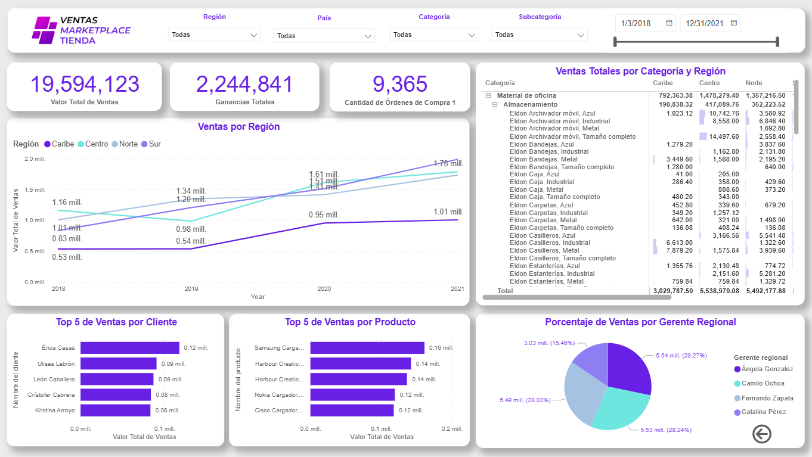

<div id="header" align="center">
  
  </div>

<br>

<h1 align="center">
  <b>Hi, I'm</b>
  <b style="color: #22b05d;">Jair Trujillo Rincon</b>
  
</h1>

<p align="center">
  <a href="https://github.com/DenverCoder1/readme-typing-svg">
    
  </a>
</p>

## 🙋 About Me

I have been learning about data analysis for over three years. I began with data analysis and later expanded into data science, machine learning, and deep learning. As my models grew more sophisticated, I realized the importance of efficiently processing large volumes of data, which led me to study data engineering. Today, I focus on building robust, end-to-end analytical solutions.

<!-- * 🖥️  See my portfolio at [miportafolio](http://app) Aqui puedo agregar los dashboards de power bi -->
* 🌍  I'm based in Medellin, Colombia
* ✉️  You can contact me at [**coremprejair@gmail.com**](mailto:coremprejair@gmail.com)
* 🚀  I'm currently working on **Data Science**
* 🧠  I'm currently enhancing my skills in **Artificial Intelligence with Python**
* 👥  I'm looking to collaborate on **Analytics** and **Data Science** projects
* 💬  Ask me about free courses and publicly available data sources

## 🎰 Proyecto: Predicción de juegos de azar (Colombia)

Este repositorio ahora incluye un pipeline base en Python para:

1. **Extraer datos** desde una fuente oficial de datos abiertos en Colombia.
2. **Normalizar resultados** en un esquema común (`draw_date`, `strategy`, `game`, `number`, `prize_type`).
3. **Entrenar modelos por estrategia/juego**.
4. **Generar predicción diaria** por cada estrategia disponible.

### Estructura agregada

- `/src/lottery_pipeline/config.py`: configuración de fuentes oficiales.
- `/src/lottery_pipeline/collector.py`: ingesta y normalización.
- `/src/lottery_pipeline/modeling.py`: entrenamiento y predicción.
- `/src/lottery_pipeline/cli.py`: interfaz de línea de comandos.

La ingesta usa la API Socrata de Datos Abiertos (`/resource/{dataset}.json`).
La fuente configurada es el dataset oficial **Resultados de los sorteos
loterías** (`i3kx-3zps`). Sus campos se detectan de forma flexible y se
normalizan al esquema interno. Si Datos Abiertos cambia el identificador, se
puede reemplazar la fuente mediante `LOTTERY_SOURCES_JSON` sin modificar el
código.

### Uso rápido

```bash
uv sync --group dev

# 1) Extraer datos
PYTHONPATH=src uv run python -m lottery_pipeline collect --limit 50000

# 2) Entrenar y predecir
PYTHONPATH=src uv run python -m lottery_pipeline train --min-rows 30

# 3) Validar como futuro sobre histórico (walk-forward)
PYTHONPATH=src uv run python -m lottery_pipeline backtest --min-rows 30
```

### Archivos de salida

- `data/raw/lottery_results.csv`: resultados normalizados.
- `data/raw/metadata.json`: metadatos de extracción.
- `models/lottery_models.pkl`: modelos entrenados por estrategia/juego.
- `predictions/daily_predictions.csv`: predicción para la fecha objetivo.

El repositorio incluye `data/lottery.db` como semilla histórica. La copia
actual contiene 1.024 resultados de Lotería de Medellín entre 2007-01-05 y
2026-10-09. El workflow diario restaura y actualiza esa base mediante cache;
los nuevos resultados se consolidan con `ON CONFLICT`, sin borrar el histórico.

### Datos, frecuencia y aprendizaje

Cada modelo se entrena por separado para cada combinación `strategy/game`, usando
el histórico del número principal de cada sorteo: fecha, número ganador,
rezagos (`lag1`, `lag7`), media móvil de siete sorteos y variables de calendario.
Los premios secundarios se conservan en SQLite y no se duplican como observaciones
de entrenamiento; se usan para evaluar si el número predicho coincide con cualquier
premio publicado.
Los juegos diarios, semanales y mensuales no se mezclan. La predicción solo se
genera cuando la fecha objetivo coincide con el patrón de sorteos observado.

El modelo actual es supervisado (`RandomForestRegressor` con suavizado
histórico), no aprendizaje reforzado. Cada predicción conserva una probabilidad
histórica para su combinación de estrategia y juego. Las evaluaciones calculan
probabilidad observada de acertar cualquier premio, el premio mayor, premios
secundarios, `hit@3`, `hit@5` y Brier por estrategia/juego; sirven para monitorear
calibración y rendimiento, pero no se usan como una falsa señal de recompensa.
En sorteos aleatorios no existe una acción controlable ni una recompensa estable
que justifique afirmar que un agente puede aprender una política ganadora.

La fuente oficial identifica categorías como `Mayor` y `Seco`. El pipeline compara
el número predicho con el número publicado en cada categoría y registra los tipos
coincidentes. Esto evalúa aciertos exactos; reglas adicionales como aproximaciones,
series o terminales requieren que la fuente publique esos campos y una definición
oficial de la regla antes de calcularlas.

### Comunicación y aprendizaje

Las alertas se envían en HTML y texto plano. Un correo agrupa todos los aciertos
pendientes de la ejecución, muestra una tabla con fecha, estrategia, juego, número
y categoría del premio, y separa el resumen entre premios mayores y secundarios.
Esto evita enviar un correo por cada coincidencia y conserva compatibilidad con
clientes que no renderizan HTML.

El sistema actual no es aprendizaje reforzado: no existe una acción sobre el
sorteo ni una recompensa que pueda modificar sus probabilidades reales. Los
“pesos” del modelo son: la frecuencia histórica suavizada de cada número y un
factor exponencial según su distancia a la predicción del Random Forest. El
Random Forest sí aprende pesos internos de sus árboles, pero no se actualizan con
los aciertos del correo. La mejora correcta es recalibrar y comparar estrategias
con validación temporal, registrando Brier y probabilidades de premio por juego;
no aumentar artificialmente la probabilidad después de un acierto aislado.

### Evaluación arquitectónica y evolución a múltiples modelos

La arquitectura actual es adecuada como MVP reproducible: ingesta oficial,
normalización, SQLite, entrenamiento por `strategy/game`, evaluación y alerta.
Sus límites principales son el tamaño desigual del histórico, la ausencia de
validación temporal automatizada, una sola familia de modelo y la falta de una
calibración formal de probabilidades. En un sorteo diseñado para ser aleatorio,
un modelo más complejo no implica una ventaja predictiva; la métrica prioritaria
debe ser la calibración fuera de muestra, no la cantidad de aciertos aparentes.

La implementación actual ya incluye un ensamble supervisado por juego, ejecutado
en paralelo:

1. Generar características sin fuga temporal: calendario, rezagos, frecuencias
   con ventana móvil y datos de cada categoría de premio.
2. Entrenar modelos independientes: `RandomForest`, `ExtraTrees`,
   `HistGradientBoosting` y `MLPRegressor` opcional cuando el histórico alcanza
   el umbral configurado.
3. Evaluarlos con validación walk-forward. Los pesos del ensamble se obtienen
   solo de las predicciones históricas fuera de muestra, usando Brier o log loss;
   nunca del último acierto ni del correo enviado.
4. Calibrar las probabilidades con `CalibratedClassifierCV` o isotonic cuando
   exista suficiente histórico. Para cada candidato se conserva modelo, versión,
   ventana de entrenamiento, métrica y peso.
5. Promediar las distribuciones de probabilidad por juego, normalizarlas y
   publicar también la predicción de cada modelo, la predicción combinada y la
   incertidumbre. Si el ensamble no supera la línea base en walk-forward, se
   mantiene la línea base.

La ejecución paralela aísla fallos por modelo mediante `concurrent.futures`,
limita el paralelismo de cada estimador y guarda artefactos versionados. El
comando `backtest` ejecuta la validación walk-forward sobre el CSV histórico.
Todavía quedan como siguientes mejoras formales la calibración isotónica, una
tabla SQLite específica de métricas por modelo y una línea base uniforme
explícita. XGBoost/LightGBM, PyTorch o una red temporal profunda solo deben
incorporarse si el backtesting demuestra una mejora estable; con el histórico
actual una red profunda tiene alto riesgo de sobreajuste.


##  🛠️ Technical Stack

<details>
<summary><strong>💻 Languages & Core Technologies</strong></summary>

<p align="center">
  <a href="https://www.python.org/">
    
  </a>
  <a href="https://www.mysql.com/">
    
  </a>
</p>

</details>

<details>
<summary><strong>🤖 Data Science & Machine Learning</strong></summary>

**Data Analysis & Processing**
<p align="center">
  <a href="https://numpy.org/">
    
  </a>
  <a href="https://pandas.pydata.org/">
    
  </a>
  <a href="https://scipy.org/">
    
  </a>
  <a href="https://openpyxl.readthedocs.io/">
    
  </a>
</p>

**Machine Learning Libraries**
<p align="center">
  <a href="https://scikit-learn.org/">
    
  </a>
  <a href="https://www.tensorflow.org/">
    
  </a>
  <a href="https://keras.io/">
    
  </a>
  <a href="https://pytorch.org/">
    
  </a>
</p>

**Data Visualization**
<p align="center">
  <a href="https://matplotlib.org/">
    
  </a>
  <a href="https://seaborn.pydata.org/">
    
  </a>
  <a href="https://plotly.com/">
    
  </a>
  <a href="https://powerbi.microsoft.com/">
    
  </a>
</p>

</details>

<details>
<summary><strong>🏗️ Data Engineering & Big Data</strong></summary>

**Distributed Computing & Processing**
<p align="center">
  <a href="https://spark.apache.org/">
    
  </a>
  <a href="https://spark.apache.org/docs/latest/api/python/">
    
  </a>
  <a href="https://hadoop.apache.org/">
    
  </a>
</p>

**Orchestration & Infrastructure**
<p align="center">
  <a href="https://airflow.apache.org/">
    
  </a>
  <a href="https://impala.apache.org/">
    
  </a>
  <a href="https://www.cloudera.com/">
    
  </a>
  <a href="https://www.sqlalchemy.org/">
    
  </a>
</p>

</details>

<details>
<summary><strong>🗄️ Databases & Data Storage</strong></summary>

**Relational Databases**
<p align="center">
  <a href="https://www.mysql.com/">
    
  </a>
  <a href="https://www.postgresql.org/">
    
  </a>
</p>

**NoSQL Databases**
<p align="center">
  <a href="https://www.mongodb.com/">
    
  </a>
  <a href="https://www.sqlite.org/">
    
  </a>
</p>

</details>

<details>
<summary><strong>🕸️ Data Collection & Web Scraping</strong></summary>

<p align="center">
  <a href="https://selenium.dev/">
    
  </a>
  <a href="https://www.crummy.com/software/BeautifulSoup/">
    
  </a>
</p>

</details>

<details>
<summary><strong>🛠️ Development Tools & Environment</strong></summary>

**Version Control**
<p align="center">
  <a href="https://git-scm.com/">
    
  </a>
  <a href="https://github.com/">
    
  </a>
</p>

**IDEs & Notebooks**
<p align="center">
  <a href="https://code.visualstudio.com/">
    
  </a>
  <a href="https://jupyter.org/">
    
  </a>
  <a href="https://www.jetbrains.com/pycharm/">
    
  </a>
</p>

**OS & Platforms**
<p align="center">
  <a href="https://ubuntu.com/">
    
  </a>
</p>

</details>

<!-- ## Dashboards

| **Dashboard 1** | **Dashboard 2** |
|---|---|
| [](https://app.powerbi.com/view?r=eyJrIjoiN2RmZmE5YjUtMmQzMy00YjhiLWE1NmEtZDg5OTBjNWU2OTA1IiwidCI6ImNhM2YxZDZiLWZkMWYtNDBiMS1iNDFhLTQ4OGI5ODBlOWY3ZiIsImMiOjR9&pageName=ReportSectioncb1ce34056930c0b40d2) | [](https://app.powerbi.com/view?r=eyJrIjoiN2RmZmE5YjUtMmQzMy00YjhiLWE1NmEtZDg5OTBjNWU2OTA1IiwidCI6ImNhM2YxZDZiLWZkMWYtNDBiMS1iNDFhLTQ4OGI5ODBlOWY3ZiIsImMiOjR9&pageName=ReportSectioncb1ce34056930c0b40d2) |
| _Descripción breve del dashboard 1._ | _Descripción breve del dashboard 2._ | -->

## 📊 GitHub Stats
<br>
<p align="center">
  <a href="https://github.com/JairTrujillo-R/beautiful-github-homepage"><picture></picture></a>
  <a href="https://github.com/JairTrujillo-R/beautiful-github-homepage"><picture></picture></a>
</p>

## 🔗 Contact Me

<div align="center">
<a href="mailto:coremprejair@gmail.com"></a>
<a href="https://www.linkedin.com/in/jairtrujillo"></a>
</div>

---

<div align="center">
<!--  -->


<a href="https://github.com/JairTrujillo-R?tab=followers">
  
</a>
<a href="https://github.com/JairTrujillo-R?tab=stars">
  
</a>

<br>

**Made with ❤️ by [Jair Trujillo](https://github.com/JairTrujillo-R)**

</div>